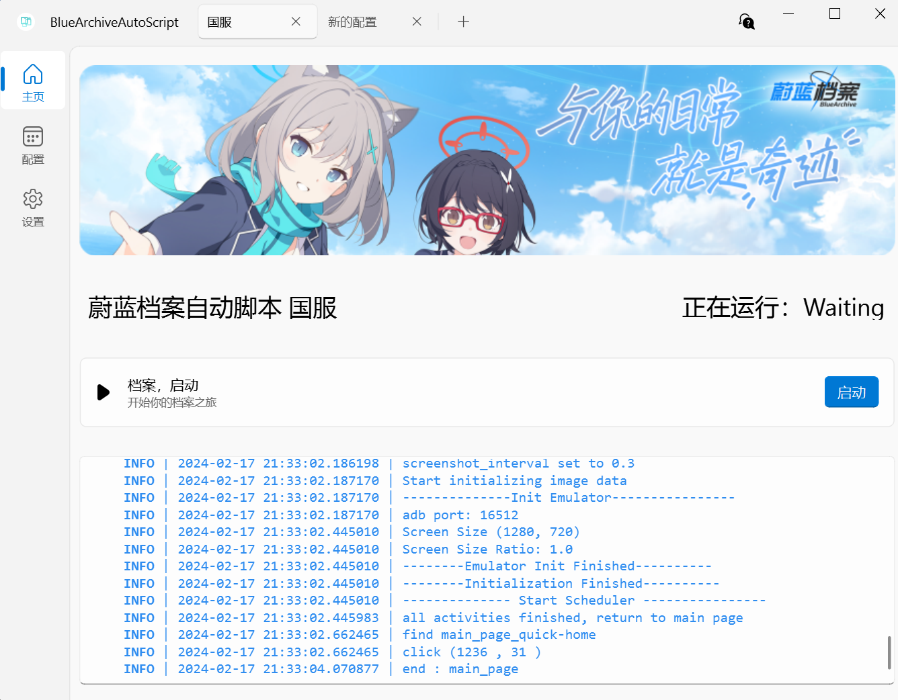
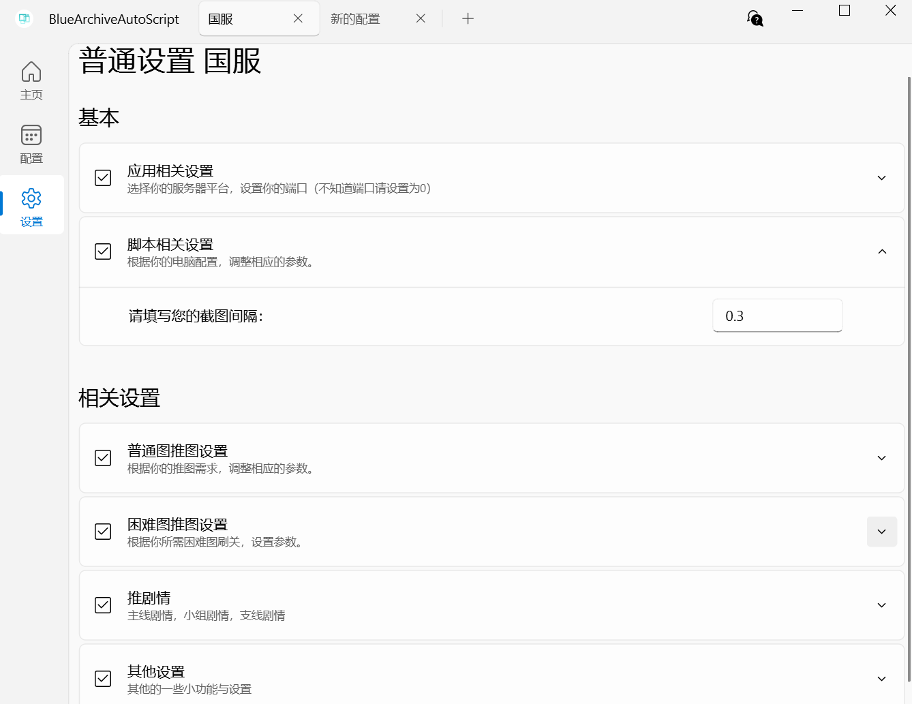
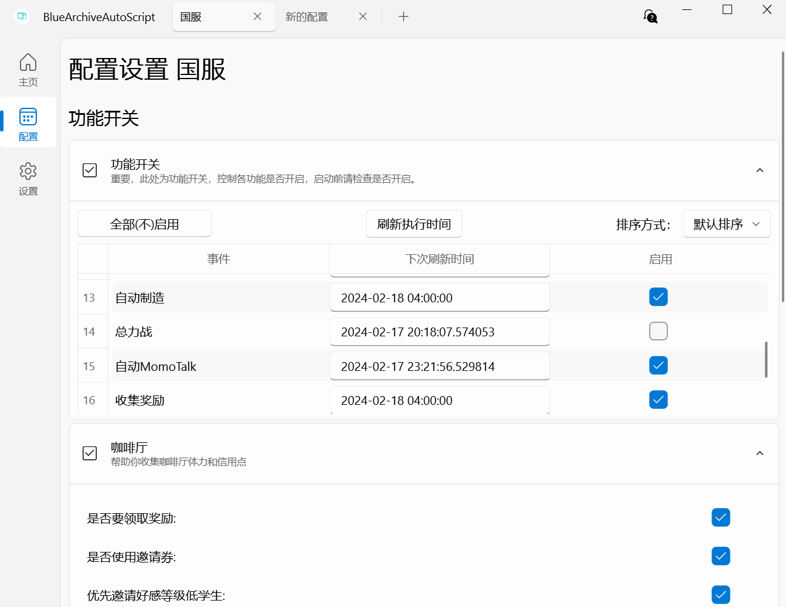

  

# Blue Archive Auto Script

[简体中文](docs/REAME_zh.md)

**BAAS** is an automation tool for Blue Archive across all regional servers. It works with 16:9 game screens, and we recommend 1280 × 720. Our goal is to automate every in-game task, from dailies to events.

## New UI · BAAS Tauri

[BAAS Tauri](https://baas.kiramei.moe/) is the new BAAS interface for Windows, macOS, Linux, and Android. It brings a visual scheduler, profile and task settings, device previews, logs, and updates together in one app.

[Download BAAS Tauri](https://github.com/Kiramei/baas-tauri/releases/latest) · [Installation guide](https://baas.kiramei.moe/docs/en/guide/install/) · [BAAS Tauri source](https://github.com/Kiramei/baas-tauri)

| Visual workflow editor | Café settings |
| --- | --- |
|  |  |

For Android setup and other deployment options, see the [BAAS Tauri docs](https://baas.kiramei.moe/docs/en/).

### Moving from the legacy UI

If your legacy desktop build supports migration, open it once to export your profiles and preferences. Then launch BAAS Tauri and choose to migrate when prompted during initial setup. On Windows, macOS, and Linux, BAAS Tauri can reuse your existing installation folder and carry over your profiles, language, theme, and any available MirrorChyan settings.

## Legacy UI · PyQt

The original BAAS desktop interface is still available. The [BAAS wiki](https://baas.wiki/) has setup and usage guides for the legacy UI.

[Legacy releases](https://github.com/pur1fying/blue_archive_auto_script/releases) · [Legacy installation guide](https://baas.wiki/usage_doc/install/choose_platform.html)

| Home and logs | General settings | Task settings |
| --- | --- | --- |
|  |  |  |

On Windows, download the legacy launcher archive from GitHub Releases or a QQ group. Qt requires an installation path without Chinese characters. Double-click `BlueArchiveAutoScript.exe` after extracting the archive and wait for it to install the runtime. The UI opens automatically when setup finishes. To build your own package with PyInstaller, see [`deploy/installer`](deploy/installer).

## What BAAS can do

| Feature | Automation |
| --- | --- |
| Student affinity | Pet students up to eight times a day in the café and prioritize specific students in lessons. |
| Missions | Clear Normal areas 4–30 and Hard areas 1–30 automatically, including Area 30. |
| Café | Invite the student of your choice with an invitation ticket, pet students, and collect café rewards. |
| Shops | Set what to buy and how many times to refresh the regular and Tactical Challenge shops. |
| Daily rewards | Collect daily club AP, mail, Tactical Challenge rewards, daily mission rewards, and Pass points and rewards. |
| AP spending | Sweep selected Normal and Hard missions, Special Commissions, and event stages as many times as you set. |
| Lessons | Prioritize selected students or lessons with higher affinity gains, and set how many lessons to take in each area. |
| Tactical Challenge | Use all challenge tickets and collect the daily reward. |
| Crafting | Automate all three crafting stages and set priorities, run counts, and whether to use Booster Tickets. |
| MomoTalk | Finish all pending conversations, complete relationship stories, and claim Pyroxene. |
| Total Assault | The ticket-clearing and reward task, including cumulative point rewards, is [currently disabled](module/total_assault.py#L9-L11). Auto-battle for high-score attempts is implemented in [BAAS_Cpp](https://github.com/pur1fying/BAAS_Cpp), with integration into BAAS still in progress. |
| Joint Firing Drill | Use all tickets while a drill is active. |
| Stories | Clear main, group, and mini stories in one go. |
| Events | Clear event stories, missions, challenges, and tile maps. Event support is updated regularly for three regional servers. |

BAAS works with 16:9 emulator resolutions, including sizes other than 1280 × 720. On slower hardware, lower the screenshot frequency and allow more time for tasks to run. You can customize scheduling with a fixed daily reset time and run intervals.

## Reporting bugs

Please spend five minutes checking and reproducing the problem before filing an [issue](https://github.com/pur1fying/blue_archive_auto_script/issues). Check that BAAS is up to date. To update the legacy version automatically, restart it using its launcher. If BAAS behaves unexpectedly, attach the UI log from the affected run and an emulator screenshot or video.

## Contributing

We post project requests in [GitHub Issues](https://github.com/pur1fying/blue_archive_auto_script/issues) and the [developer guide](https://blog.lzwi.fun/blue_archive_auto_script/develop_doc/develop_guide). Pull requests are welcome, and we'll review your code carefully.

- BAAS uses YOLOv8 to detect characters in auto-battle. Contact the maintainer if you'd like to help label training data.
- Help translate the UI. The legacy GUI has English, Simplified Chinese, Japanese, and Korean.
- Help more people find BAAS. Stream automated high-score attempts on Bilibili or make tutorials for your favorite video platform.

## Known issues

- **Avoid using BAAS while playing VALORANT.** You may receive a temporary suspension lasting several hours.
- The Docker proof of concept in [`deploy/docker`](deploy/docker) does not run. Fixes are welcome. See the [WebUI and Docker guide](https://baas.kiramei.moe/docs/en/guide/webui/) for the new setup.

## Community

- QQ group 1 · `658302636`
- QQ group 2 · `1027430247`
- Interested in development? Email maintainer [pur1fying](mailto:2274916027@qq.com).

## Roadmap

BAAS is a student-led open-source project. Come build it with us!

- Continue rewriting parts of BAAS in C++ in [BAAS_Cpp](https://github.com/pur1fying/BAAS_Cpp).
- Build an auto-battle UI anyone can use.
- Make AP planning more flexible during ×2 and ×3 drop campaigns, with different stage choices and AP purchases.
- Add Pyroxene farming for new Tactical Challenge seasons.

## Acknowledgments

Thanks to everyone who has helped build BAAS. See the [acknowledgments](https://baas.wiki/thanks) and [contributors](https://github.com/pur1fying/blue_archive_auto_script/graphs/contributors).

BAAS is available under the [GNU General Public License v3.0](LICENSE).
