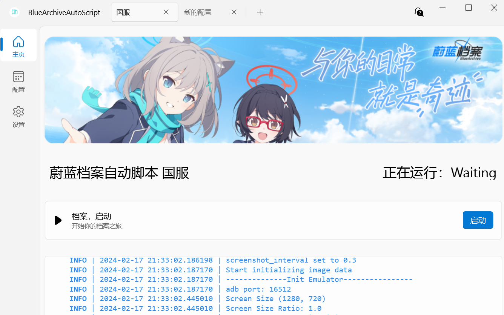
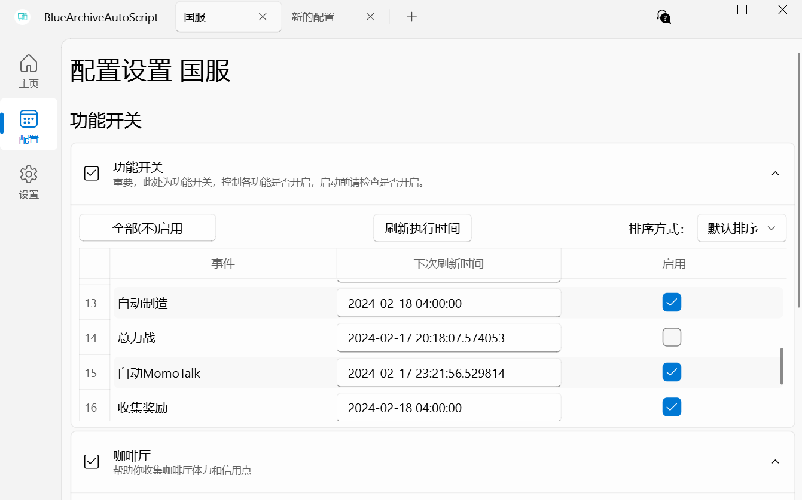
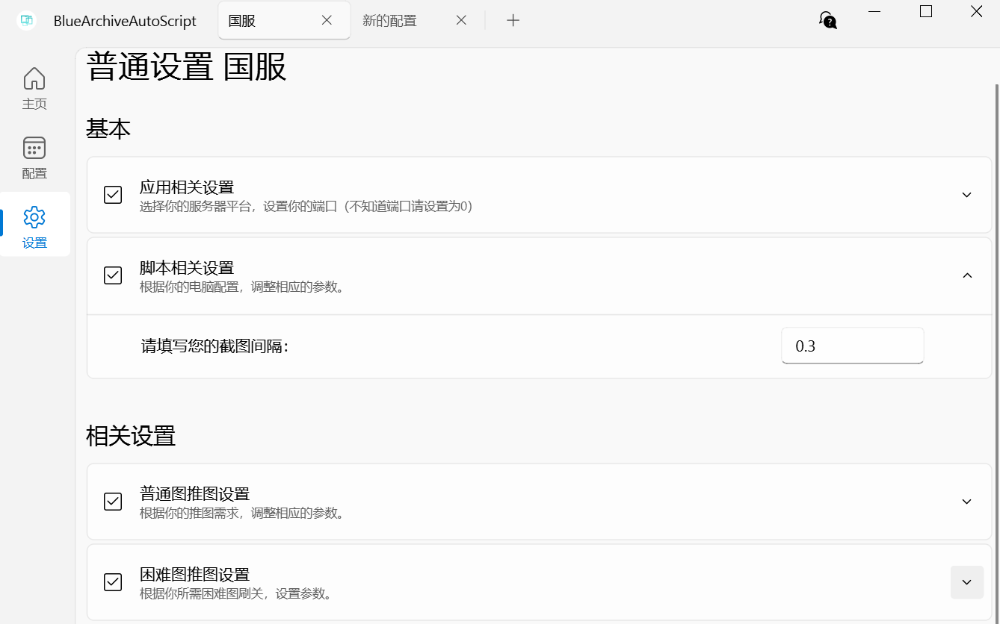

# Blue Archive Auto Script

**《蔚蓝档案》全区服自动化工具，挂机也能清完日常。** 
日常、活动、咖啡厅、商店、剧情，交给 BAAS 就好。

  <a href="../README.md"><kbd>English</kbd></a>
  <kbd><b>简体中文</b></kbd>

  <a href="#-快速开始"><kbd>下载</kbd></a>
  <a href="#-功能一览"><kbd>功能</kbd></a>
  <a href="https://baas.kiramei.moe/docs/zh/"><kbd>文档</kbd></a>
  <a href="https://baas.wiki/"><kbd>Wiki</kbd></a>
  <a href="#-如何上报-bug"><kbd>上报 Bug</kbd></a>
  <a href="#-参与开发"><kbd>参与开发</kbd></a>

---

**BAAS** 是一款支持全区服的《蔚蓝档案》自动化工具，适用于任意 16:9 的游戏画面（推荐 1280 × 720）。我们的目标很简单：让日常、活动等所有游戏任务都能自动完成。

  

## 🚀 快速开始

  仍在使用旧版界面？
  <a href="https://github.com/pur1fying/blue_archive_auto_script/releases"><kbd>旧版发布页</kbd></a>
  <a href="https://baas.wiki/usage_doc/install/choose_platform.html"><kbd>旧版安装文档</kbd></a>
  <a href="https://github.com/Kiramei/baas-tauri"><kbd>BAAS Tauri 源码</kbd></a>

> [!TIP]
> Android 安装、WebUI 及其他部署方式请参阅 [BAAS Tauri 文档](https://baas.kiramei.moe/docs/zh/)。

<b>🔄 从旧版界面迁移</b>

 

1. 如果你的旧版桌面客户端支持迁移，先打开旧版一次，导出配置和偏好设置。
2. 启动 BAAS Tauri，在首次设置时按提示选择迁移。

在 Windows、macOS 和 Linux 上，BAAS Tauri 可以沿用原安装目录，并带入已有配置、语言、主题以及可用的 MirrorChyan 设置。

<b>🧩 在 Windows 上安装旧版界面</b>

 

1. 从 [GitHub 发布页](https://github.com/pur1fying/blue_archive_auto_script/releases)或 QQ 群下载旧版启动器压缩包。
2. 解压到**不含中文的路径**（受 Qt 限制）。
3. 双击 `BlueArchiveAutoScript.exe`，耐心等待运行环境安装，完成后界面会自动打开。

想用 PyInstaller 自行打包的话，请查看 [`deploy/installer`](../deploy/installer)。更多用法详见 [BAAS Wiki](https://baas.wiki/)。

## 🖼️ 新旧界面对比

<table>
<tr>
<th width="50%">✨ BAAS Tauri</th>
<th width="50%">🧩 旧版界面</th>
</tr>
<tr><td colspan="2" align="center"><b>首页与日志</b></td></tr>
<tr>
<td></td>
<td></td>
</tr>
<tr><td colspan="2" align="center"><b>任务与调度</b></td></tr>
<tr>
<td></td>
<td></td>
</tr>
<tr><td colspan="2" align="center"><b>设置</b></td></tr>
<tr>
<td></td>
<td></td>
</tr>
</table>

<b>📋 功能对比</b>

 

| | ✨ BAAS Tauri | 🧩 旧版界面 |
| --- | --- | --- |
| **支持平台** | Windows · macOS · Linux · Android | Windows；macOS 与 Linux 需从源码安装 |
| **安装方式** | 下载安装即可 | 解压到不含中文的路径，等待运行环境安装（Windows）；conda + pip（macOS / Linux） |
| **任务调度** | 可视化调度与工作流编辑器 | 任务列表 |
| **设备画面预览** | ✅ 实时预览 | — |
| **日志** | ✅ | ✅ |
| **更新** | ✅ 应用内更新 | ✅ 重启启动器更新 |
| **WebUI / Docker** | ✅ [部署指南](https://baas.kiramei.moe/docs/zh/guide/webui/) | — |
| **Android** | ✅ | — |

## 🎯 功能一览

| | 功能 | 支持内容 |
| :-: | --- | --- |
| 💗 | **学生好感度** | 咖啡厅每天最多摸头八次，日程优先找指定学生，尽量拉满每日好感。 |
| 🗺️ | **主线推图** | 自动推图，支持普通第 4–30 区和困难第 1–30 区，第 30 区已适配。 |
| ☕ | **咖啡厅** | 用邀请券邀请指定学生，摸头并领取咖啡厅收益。 |
| 🛒 | **商店** | 自定义普通商店和竞技场商店的购买项目与刷新次数。 |
| 🎁 | **日常领奖** | 领取小组体力、邮箱、竞技场每日奖励、每日任务奖励，以及 Pass 点数和奖励。 |
| ⚡ | **体力清理** | 按设定次数扫荡指定的普通/困难主线、特别委托和活动关卡。 |
| 📚 | **日程** | 优先选择有指定学生或好感收益更高的日程，可设置各区域的执行次数。 |
| ⚔️ | **竞技场** | 自动清空挑战券并领取每日奖励。 |
| 🔨 | **制造** | 自动完成三阶段制造，可设置优先级、次数以及是否使用加速券。 |
| 💬 | **MomoTalk** | 完成未结束的对话和羁绊剧情，顺手领取青辉石。 |
| 🎯 | **战术综合测试** | 测试开启期间自动清票。 |
| 📖 | **剧情** | 一键清理主线剧情、小组剧情和迷你剧情。 |
| 🎉 | **活动** | 一键推进活动剧情、任务、挑战和走格子，三个服务器的活动持续适配。 |
| 🏆 | **总力战** | 清票及领奖任务[当前已停用](../module/total_assault.py#L9-L11)。自动凹分战斗已在 [BAAS_Cpp](https://github.com/pur1fying/BAAS_Cpp) 适配，正在接入 BAAS。 |

> [!NOTE]
> BAAS 可在任意 16:9 分辨率的模拟器上运行，不限于 1280 × 720。低配电脑可以调低截图频率，并给任务留出更多运行时间。调度支持自定义每日固定刷新时间和执行间隔。

## ⚠️ 已知问题

> [!WARNING]
> **请勿在使用 BAAS 时游玩《无畏契约》（VALORANT）。** 可能会受到数小时的封号处罚。

## 🐞 如何上报 Bug

提交 [Issue](https://github.com/pur1fying/blue_archive_auto_script/issues) 前，请先花五分钟检查并复现问题：

- [ ] 确认 BAAS 已是最新版本。旧版通过启动器重启即可自动更新。
- [ ] 附上出问题那次运行的界面日志。
- [ ] 附上模拟器截图或录屏。

## 🤝 参与开发

我们会在 [GitHub Issues](https://github.com/pur1fying/blue_archive_auto_script/issues) 和[开发文档](https://blog.lzwi.fun/blue_archive_auto_script/develop_doc/develop_guide)发布需求。欢迎提交 Pull Request，每一份代码我们都会认真阅读。你还可以：

- 🏷️ **标注数据**：BAAS 的自动战斗使用 YOLOv8 识别角色，愿意帮忙标注训练数据的话欢迎联系作者。
- 🌐 **翻译界面**：旧版已支持简体中文、英语、日语和韩语。
- 📣 **推广 BAAS**：在哔哩哔哩直播自动凹分，或在各视频平台制作使用教程。

## 🧭 未来目标

我们是学生党，欢迎大家一起来开发 BAAS！

- [ ] 继续在 [BAAS_Cpp](https://github.com/pur1fying/BAAS_Cpp) 用 C++ 重构部分功能
- [ ] 为自动战斗开发一个普通用户也能上手的界面
- [ ] 完善体力规划，让双倍、三倍掉落期间的刷图和买体力更灵活
- [ ] 增加竞技场新赛季的青辉石挖矿功能

## 💬 联系我们

| 渠道 | |
| --- | --- |
| QQ 一群 | `658302636` |
| QQ 二群 | `1027430247` |
| 开发合作 | 给作者 [pur1fying](mailto:2274916027@qq.com) 发邮件 |

## 💖 致谢

感谢所有为 BAAS 出力的朋友！完整名单见[致谢页面](https://baas.wiki/thanks)和[贡献者列表](https://github.com/pur1fying/blue_archive_auto_script/graphs/contributors)。

  

---

BAAS 基于 <a href="../LICENSE">GNU 通用公共许可证 v3.0</a> 发布。

