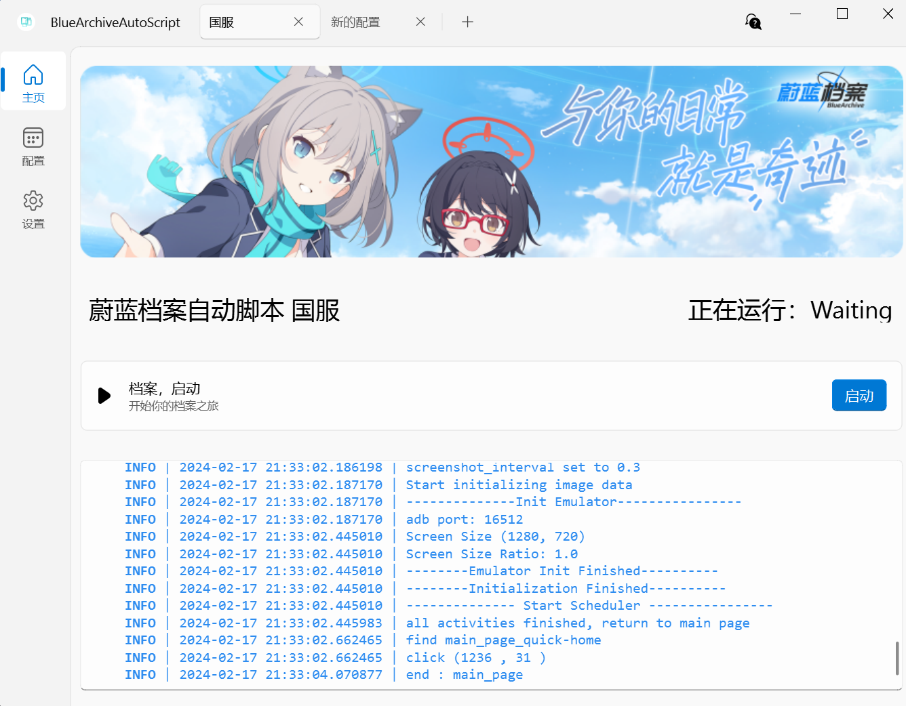
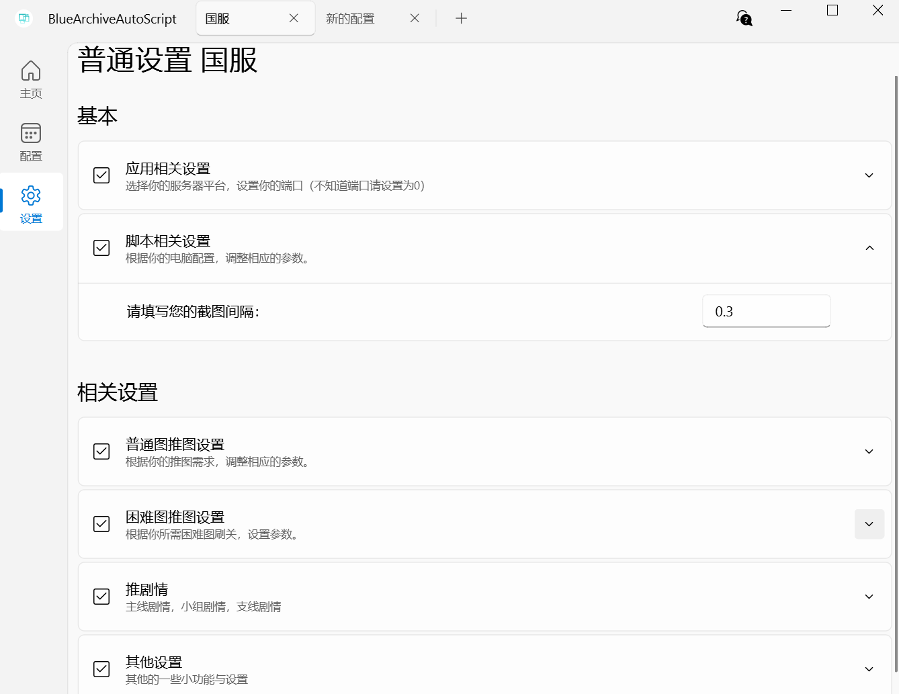
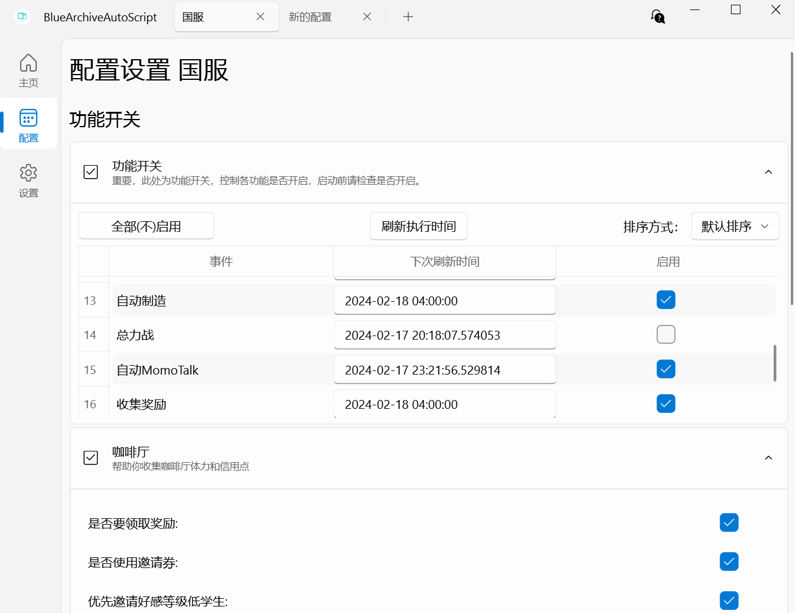

  

# Blue Archive Auto Script

[English](../README.md)

**BAAS** 是一款支持全区服的《蔚蓝档案》自动化工具。它适用于 16:9 的游戏画面，推荐分辨率为 1280 × 720。我们的目标是让日常、活动等各类游戏任务都能自动完成。

## 新版界面 · BAAS Tauri

[BAAS Tauri](https://baas.kiramei.moe/) 是 BAAS 的新版界面，支持 Windows、macOS、Linux 和 Android。可以在同一个应用里使用可视化调度、管理配置和任务、预览设备画面、查看日志和更新。

[下载 BAAS Tauri](https://github.com/Kiramei/baas-tauri/releases/latest) · [安装指南](https://baas.kiramei.moe/docs/zh/guide/install/) · [BAAS Tauri 源码](https://github.com/Kiramei/baas-tauri)

| 可视化工作流编辑器 | 咖啡厅设置 |
| --- | --- |
|  |  |

Android 的安装和其他部署方式请参阅 [BAAS Tauri 文档](https://baas.kiramei.moe/docs/zh/)。

### 从旧版界面迁移

如果你的旧版桌面客户端支持迁移，请先打开旧版一次，导出配置和偏好设置。然后启动 BAAS Tauri，在首次设置时按提示选择迁移。在 Windows、macOS 和 Linux 上，BAAS Tauri 可以沿用原安装目录，并带入已有配置、语言、主题以及可用的 MirrorChyan 设置。

## 旧版界面 · PyQt

原有的 BAAS 桌面界面仍可使用。旧版配置和用法详见 [BAAS Wiki](https://baas.wiki/)。

[旧版发布页](https://github.com/pur1fying/blue_archive_auto_script/releases) · [旧版安装文档](https://baas.wiki/usage_doc/install/choose_platform.html)

| 首页与日志 | 通用设置 | 任务设置 |
| --- | --- | --- |
|  |  |  |

Windows 用户可以从 GitHub 发布页或 QQ 群下载旧版启动器压缩包。受 Qt 限制，请解压到不含中文的路径。双击 `BlueArchiveAutoScript.exe`，耐心等待运行环境安装，完成后界面会自动打开。如果想用 PyInstaller 自行打包，请查看 [`deploy/installer`](../deploy/installer)。

## 功能

| 功能 | 支持内容 |
| --- | --- |
| 学生好感度 | 咖啡厅一天最多摸头八次，日程优先找指定学生，尽量提高每日好感度。 |
| 主线关卡 | 自动推图，支持普通第 4–30 区和困难第 1–30 区，第 30 区已适配。 |
| 咖啡厅 | 使用邀请券邀请指定学生，摸头并领取咖啡厅奖励。 |
| 商店 | 可指定普通商店和竞技场商店的购买项目和刷新次数。 |
| 日常领奖 | 领取小组体力、邮箱、竞技场每日奖励、每日任务奖励，以及 Pass 任务点数和奖励。 |
| 体力清理 | 指定普通或困难主线、特别委托、活动关卡，并设置扫荡次数。 |
| 日程 | 优先选择有指定学生或好感度收益较高的日程，可指定各区域的执行次数。 |
| 竞技场 | 自动清空挑战券并领取每日奖励。 |
| 制造 | 自动完成三阶段制造，可设置制造优先级、次数和是否使用加速券。 |
| MomoTalk | 自动完成未结束的对话和羁绊剧情，领取青辉石。 |
| 总力战 | 清票及领奖任务（含累计积分奖励）[当前已停用](../module/total_assault.py#L9-L11)。自动凹分的战斗功能已在 [BAAS_Cpp](https://github.com/pur1fying/BAAS_Cpp) 适配，正在接入 BAAS。 |
| 战术综合测试 | 测试开启期间自动清票。 |
| 剧情 | 一键清理主线剧情、小组剧情和迷你剧情。 |
| 活动 | 一键推进活动剧情、任务、挑战和走格子。三个服务器的活动会持续更新适配。 |

BAAS 可在 16:9 分辨率的模拟器上运行，推荐使用 1280 × 720。低配电脑可以调低截图频率，同时给任务留出更多运行时间。调度支持自定义每日固定刷新时间和执行间隔。

## 如何上报 Bug

提交 [Issue](https://github.com/pur1fying/blue_archive_auto_script/issues) 前，请先花五分钟检查和复现问题。确认 BAAS 已更新到最新版本，旧版可以通过启动器重启以自动更新。如果 BAAS 的行为不符合预期，请附上出问题时的界面日志，以及模拟器截图或视频。

## 参与开发

我们会在 [GitHub Issues](https://github.com/pur1fying/blue_archive_auto_script/issues) 和[开发文档](https://blog.lzwi.fun/blue_archive_auto_script/develop_doc/develop_guide)发布需求。欢迎向 BAAS 提交 Pull Request，我们会认真阅读你的代码。

- BAAS 的自动战斗使用 YOLOv8 检测游戏角色。愿意帮忙标注数据的话，欢迎联系作者。
- 欢迎帮忙翻译界面。旧版已有简体中文、英语、日语和韩语。
- 欢迎帮忙推广 BAAS。可以在哔哩哔哩直播自动战斗凹分，也可以在各视频平台制作使用教程。

## 已知问题

- **请勿在使用 BAAS 时游玩《无畏契约》（VALORANT）。** 可能会受到数小时的封号处罚。
- [`deploy/docker`](../deploy/docker) 中的旧版 Docker 部署方案目前无法运行，欢迎提交修复。新版部署方式见 [WebUI 与 Docker 指南](https://baas.kiramei.moe/docs/zh/guide/webui/)。

## 联系我们

- QQ 一群 `658302636`
- QQ 二群 `1027430247`
- 想参与开发的话，欢迎给作者 [pur1fying](mailto:2274916027@qq.com) 发邮件。

## 未来目标

我们是学生党，欢迎大家一起来开发 BAAS！

- 继续在 [BAAS_Cpp](https://github.com/pur1fying/BAAS_Cpp) 用 C++ 重构部分功能。
- 为自动战斗开发一个普通用户也能上手的界面。
- 完善体力规划，让二倍、三倍掉落活动期间的刷图和购买体力更灵活。
- 增加竞技场新赛季的青辉石挖矿功能。

## 致谢

感谢所有为 BAAS 出力的朋友，也欢迎查看[致谢名单](https://baas.wiki/thanks)和[贡献者列表](https://github.com/pur1fying/blue_archive_auto_script/graphs/contributors)。

BAAS 使用 [GNU 通用公共许可证 v3.0](../LICENSE)。
